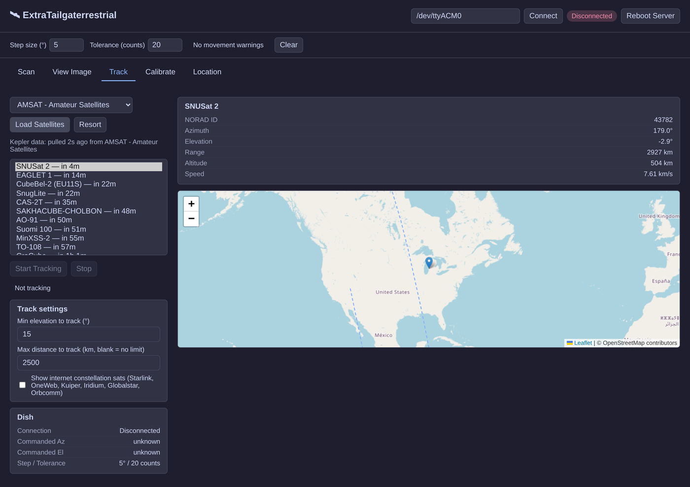

# Tailgater Microwave Imaging & Satellite Tracking

Turns a portable "Tailgater" satellite dish into a Ku-band RF camera and a real-time satellite
tracker, controlled entirely over USB serial. Scan the sky for RF sources, track satellites live
with az/el pointing, and calibrate the dish's pointing accuracy — all from one native desktop app
or a browser.

**Credit:** built on [Gabe Emerson / Saveitforparts's](https://youtu.be/lVOTZxNCgTM) original
Tailgater serial-protocol reverse-engineering and scan pipeline (2023).



## Hardware you'll need

- A Dish Network "Tailgater" portable antenna with a USB port on the mainboard (tested on a 2014
  octagonal unit; partial support on 2011 mini-USB units)
- An A-to-A USB cable
- 13–18V DC power over the coax F connector (from a receiver, power injector, or DC adapter — the
  USB port alone carries data only)
- A Linux or Windows (10/11, 64-bit) PC

## Install

Each [release](https://github.com/GooseThings/ExrtaTailgaterrestrial/releases) has ready-made
packages, built automatically by GitHub Actions:

| Package | For |
|---|---|
| `extratailgaterrestrial_<version>_all.deb` | Debian/Ubuntu: desktop app with a start-menu entry |
| `ExtraTailgaterrestrial-<version>-setup.exe` | Windows 10/11: installer with a Start-menu entry |
| `extratailgaterrestrial-<version>-linux-x86_64` | Any 64-bit Linux: single file, no install, browser UI |

**Debian/Ubuntu:**

```
sudo apt install ./extratailgaterrestrial_<version>_all.deb
```

Install needs internet the first time (the package sets up its own Python environment) and takes
a few minutes. Remove it with `sudo apt remove extratailgaterrestrial` (or `apt purge`). You'll
likely need your user in the `dialout` group to open the dish's serial port; the package tells
you the exact command if you're not.

**Windows:** run the setup `.exe`. It installs for your user without needing admin rights (or
for all users if you choose), and uninstalls from Settings → Apps. The app opens in its own
window using the Edge WebView2 runtime that comes with Windows 10/11. Windows may warn that the
installer is from an unknown publisher, because it isn't code-signed; choose **More info → Run
anyway**.

**Portable Linux binary:** make it executable and run it, then open http://localhost:5000:

```
chmod +x extratailgaterrestrial-<version>-linux-x86_64
./extratailgaterrestrial-<version>-linux-x86_64
```

It keeps its settings and scans in the directory you run it from.

### Building it yourself

- **`.deb`:** `./install.sh`, then `./build_deb.sh`. To reinstall a rebuilt package with the same
  version number, add `--reinstall`.
- **Portable Linux binary:** `./install.sh`, then `./build_standalone.sh` → `dist/dish_web`.
- **Windows installer** (on Windows, with Python and [Inno Setup 6](https://jrsoftware.org/isinfo.php)):
  `powershell -ExecutionPolicy Bypass -File packaging\windows\build.ps1` →
  `dist\ExtraTailgaterrestrial-<version>-setup.exe`.

To run from source instead, `./install.sh` sets up a venv; then either:

```
python3 dish_app.py      # native window (needs: pip install pywebview pyside6 qtpy)
python3 dish_web.py      # browser at http://localhost:5000 — also the right choice headless,
                          # or to reach the UI from another device on the same network
```

### Releasing

Bump `__version__` in `version.py`, commit, then publish a GitHub release tagged `v<version>`.
The [Release packages](.github/workflows/release-packages.yml) workflow builds all three
packages, checks each one starts and serves its page, and attaches them to the release. Run the
workflow by hand from the Actions tab for a test build without releasing.

## Using it

Connect the dish via USB and power it over the coax jack. The app finds the dish's serial port
by itself and fills it in next to **Connect**: usually `/dev/ttyACM0` on Linux, or a `COM` port on
Windows. If it guesses wrong, type the port in. On Linux, `lsusb` should list "Microchip
Technology, Inc. CDC RS-232 Emulation Demo"; on Windows it should appear under **Ports (COM &
LPT)** in Device Manager. Then, in the app:

| Tab | What it does |
|---|---|
| **Scan** | Sweeps the dish across an az/el range, recording RF signal strength at each point, with a live heatmap preview. Saved scans can be re-rendered as heatmaps (with optional interpolation) on the same page |
| **Track** | Pulls live TLE data and drives the dish to follow a satellite in real time, with a live ground-track map |
| **Calibrate** | Points at known Ku-band DBS satellites and compares theory vs. measured signal peak to check (and correct) pointing accuracy |
| **Manual** | Point the dish at a typed-in az/el (stepped or one continuous move, with Stop), watch a live signal meter and 2-minute graph, and run point-to-point sweeps that plot signal along a straight line and save it as CSV |
| **Location** | Sets where the dish is sitting, used for all tracking/calibration math |

One quirk worth knowing: the Tailgater measures azimuth **counter-clockwise** from the coax jack
("North" = 0°), backwards from a standard compass — the app handles this conversion internally, but
raw saved data is in the dish's own frame. Valid elevation is roughly 5–70°.

The app converts degrees to the board's raw sensor counts itself and moves with the firmware's
closed-loop `azacc`/`elacc` commands (accurate to about ±2 counts). It skips the firmware's own
degree commands, whose azimuth table is broken between 200° and 212°. The board's full command
set, NVRAM layout and quirks are documented in [docs/FIRMWARE.md](docs/FIRMWARE.md).

## Satellite data

The Track tab can load from Celestrak, AMSAT, or Space-Track. Before each download the app checks
the server is reachable, and tells you if it isn't.

Space-Track needs a [free account](https://www.space-track.org/auth/createAccount). Its sources
only appear once you save the login as `space_track_credentials.json`:

```
{"username": "you@example.com", "password": "…"}
```

Where it goes depends on how you run the app:

- **`.deb`:** `~/.local/share/extratailgaterrestrial/`
- **Windows installer:** `%LOCALAPPDATA%\ExtraTailgaterrestrial\`
- **Portable binary or from source:** the directory you run the app from

 Keep it private with
`chmod 600 space_track_credentials.json` on Linux. If it's missing, the Track tab says where it looked.

Celestrak downloads follow its [usage policy](https://celestrak.org/usage-policy.php):

- Each list is downloaded at most once every 2 hours. Loads in between use a local copy.
- After any error reply, all Celestrak requests pause for 2 hours. The app uses the local copy
  if it has one, otherwise AMSAT, and tells you why.
- Data is fetched as CSV, so satellites numbered 100000 and up are included.

Command-line scripts (`dish_scan.py`, `dish_image.py`, `dish_track.py`) are also available for
scripting/automation outside the app — see the comment header at the top of each file.

## Caveats

Experimental amateur radio/RF work, not built by an RF engineer — expect rough edges. Windows
support is new and hasn't been tested with a real dish yet. Issues and PRs welcome.

## License

[Unlicense](LICENSE) — public domain.
